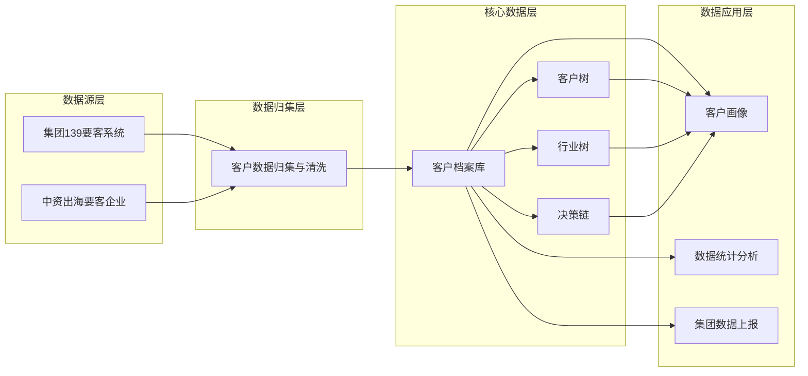
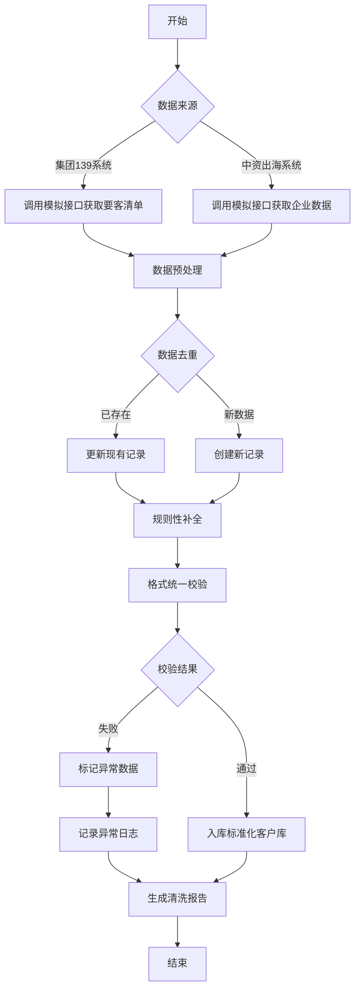
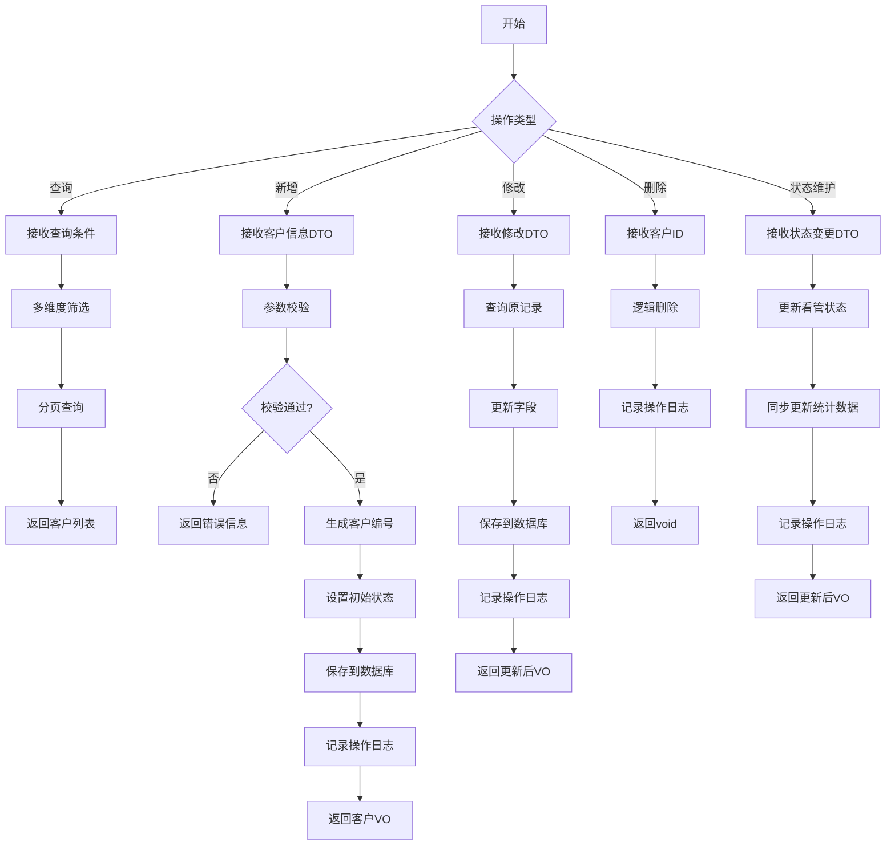
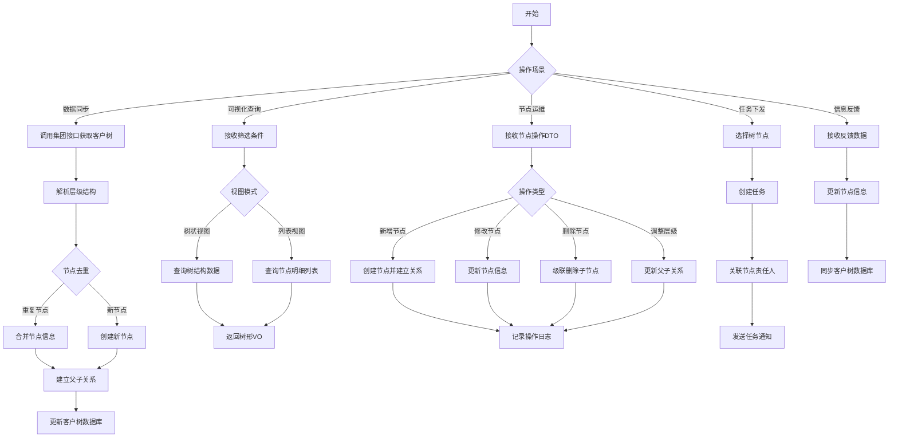
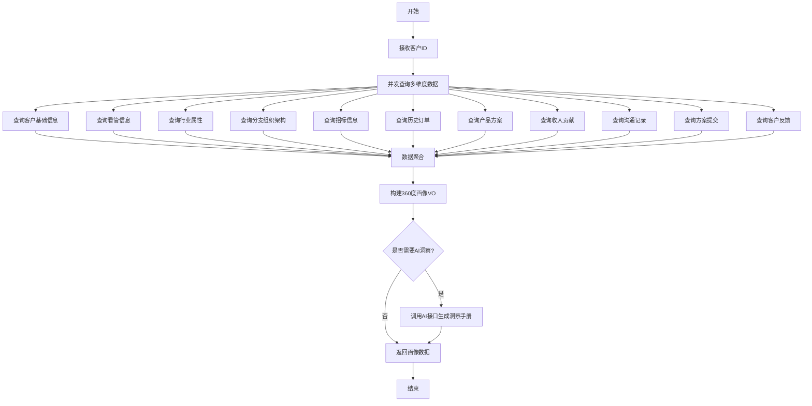
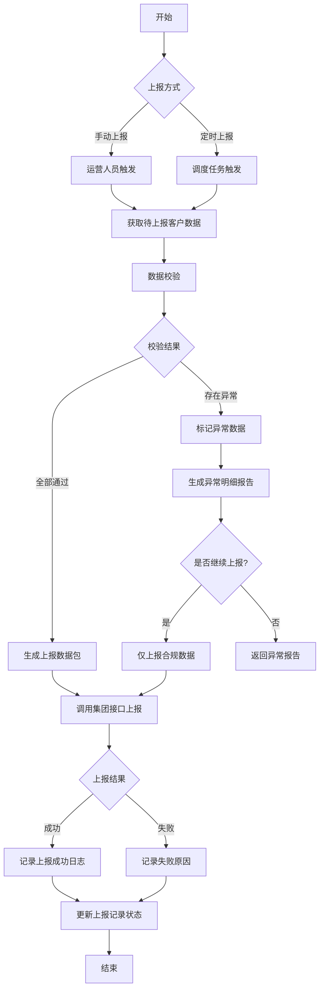
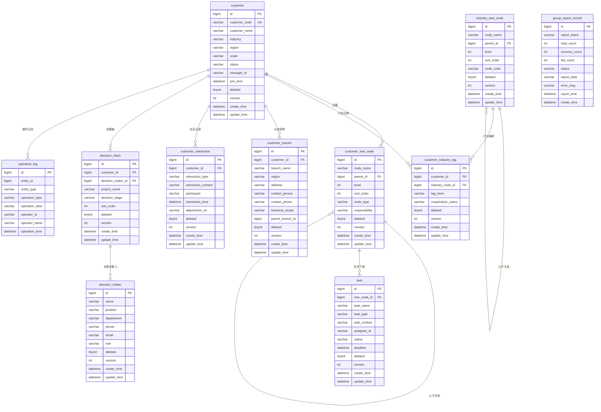
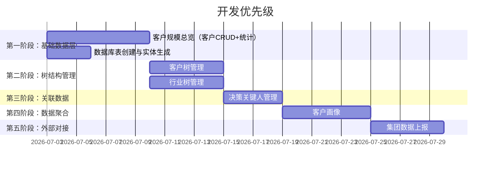

# CMI 要客运营平台 - 客户管理模块系统设计文档

> 文档版本：v1.0  
> 创建日期：2026-07-02  
> 项目：客户中心模块  
> 技术栈：Java 17 + Spring Boot 3.5.16 + MyBatis-Plus 3.5.16 + MySQL 5.7.31

---

## 一、系统概述

### 1.1 系统定位

客户管理模块是 CMI 要客运营平台的基础数据支撑层，负责归集、清洗、标准化存储全量客户数据，为上层业务模块提供统一、标准、完整的客户 360 度全景数据，支撑全链路运营活动开展。

### 1.2 核心目标

- **数据归集**：实时同步集团 139 要客清单、中资出海要客企业全量数据
- **数据标准化**：完成多源数据的去重、补全、格式统一校验
- **全景视图**：构建客户 360 度画像，支撑业务决策
- **运营支撑**：提供客户树、行业树、决策链等多维度管理工具
- **数据上报**：实现与集团系统的数据同步和上报

### 1.3 技术架构

```
┌─────────────────────────────────────────────────────────┐
│                      前端 (Vue.js)                       │
└────────────────────────┬────────────────────────────────┘
                         │ RESTful API
┌────────────────────────▼────────────────────────────────┐
│                  客户管理后端服务                          │
│  ┌──────────┐  ┌──────────┐  ┌──────────┐               │
│  │Controller│  │ Service  │  │  Mapper  │               │
│  └──────────┘  └──────────┘  └──────────┘               │
│         │              │              │                 │
│  ┌──────▼──────────────▼──────────────▼──────┐          │
│  │         MyBatis-Plus + MySQL              │          │
│  └───────────────────────────────────────────┘          │
└─────────────────────────────────────────────────────────┘
                         │
        ┌────────────────┼────────────────┐
        │                │                │
┌───────▼─────┐  ┌──────▼──────┐  ┌─────▼──────┐
│ 集团139系统  │  │ 中资出海系统│    │  Redis     │
│  (模拟接口)  │  │ (模拟接口)  │    │  (缓存)    │
└─────────────┘  └─────────────┘  └────────────┘
```

### 1.4 功能模块概览

| 模块 | 功能描述 | 核心能力 |
|------|----------|----------|
| 客户规模总览 | 客户数据归集、清洗、统计、档案运维 | 数据看板、CRUD、状态管理 |
| 客户树管理 | 集团客户树结构维护与业务协同 | 树结构可视化、节点运维、任务下发 |
| 决策关键人管理 | 决策链信息归集与应用 | 决策人档案、链路查询、数据归档 |
| 行业树管理 | 行业分类树与客户标签管理 | 行业树可视化、标签运维、穿透分析 |
| 客户画像 | 客户 360 度全景数据聚合 | 画像构建、分支树、AI洞察 |
| 集团数据上报 | 数据上报集团系统 | 数据监控、校验、同步上报 |

---

## 二、业务功能拆分图

### 2.1 功能模块层级拆分

```mermaid
graph TD
    A[客户管理模块] --> B[客户规模总览]
    A --> C[客户树管理]
    A --> D[决策关键人管理]
    A --> E[行业树管理]
    A --> F[客户画像]
    A --> G[集团数据上报管理]
    
    B --> B1[客户数据归集与清洗]
    B --> B2[数据统计与分析]
    B --> B3[客户档案运维]
    
    B1 --> B1a[多源客户数据归集]
    B1 --> B1b[客户数据标准化清洗]
    
    B2 --> B2a[核心指标自动统计计算]
    B2 --> B2b[多维度条件组合筛选]
    B2 --> B2c[全局-细分维度下钻分析]
    
    B3 --> B3a[客户清单基础信息查询]
    B3 --> B3b[客户清单新增/修改/删除]
    B3 --> B3c[客户看管状态维护]
    
    C --> C1[客户树数据归集]
    C --> C2[可视化分析]
    C --> C3[节点运维]
    C --> C4[业务协同]
    
    C1 --> C1a[集团客户树数据同步]
    C1 --> C1b[客户树数据规整去重]
    
    C2 --> C2a[客户树多维度筛选]
    C2 --> C2b[客户树节点数据统计]
    C2 --> C2c[客户树视图模式切换]
    
    C3 --> C3a[客户树节点新增/修改/删除]
    C3 --> C3b[客户树层级关系调整]
    
    C4 --> C4a[客户树节点任务下发]
    C4 --> C4b[客户树节点信息反馈]
    
    D --> D1[决策链信息归集]
    D --> D2[决策链信息运维]
    D --> D3[决策链信息应用]
    
    D1 --> D1a[决策链信息归集录入]
    
    D2 --> D2a[决策人档案新增/修改/删除]
    D2 --> D2b[决策链全链路信息更新]
    
    D3 --> D3a[决策链信息查询展示]
    D3 --> D3b[决策链数据沉淀归档]
    
    E --> E1[行业树可视化分析]
    E --> E2[客户分类运维]
    E --> E3[业务分析]
    
    E1 --> E1a[行业树层级化展示]
    E1 --> E1b[行业树节点聚合数据展示]
    E1 --> E1c[行业树节点明细下钻]
    
    E2 --> E2a[客户两级分类标签设置]
    E2 --> E2b[客户标签批量运维管理]
    
    E3 --> E3a[行业树节点资源穿透分析]
    
    F --> F1[画像数据聚合]
    F --> F2[画像构建]
    F --> F3[画像应用]
    
    F1 --> F1a[客户360度基础信息聚合]
    F1 --> F1b[客户业务数据聚合]
    F1 --> F1c[客户全交互记录聚合]
    
    F2 --> F2a[客户分支树可视化构建]
    
    F3 --> F3a[客户分支业务穿透分析]
    F3 --> F3b[画像页关联营销任务发起]
    F3 --> F3c[AI生成行业客户洞察手册]
    
    G --> G1[上报数据监控]
    G --> G2[数据同步上报]
    G --> G3[系统对接]
    
    G1 --> G1a[集团上报数据可视化总览]
    G1 --> G1b[异常上报明细查询定位]
    
    G2 --> G2a[集团数据手动同步上报]
    G2 --> G2b[集团数据定时同步上报]
    
    G3 --> G3a[集团139要客系统标准对接]
```



### 2.2 功能模块数据依赖关系



---

## 三、业务流程图

### 3.1 客户数据归集与清洗流程



### 3.2 客户档案管理流程



### 3.3 客户树管理流程



### 3.4 客户画像聚合流程



### 3.5 集团数据上报流程



---

## 四、数据建模

### 4.1 ER 图



### 4.2 数据表详细设计

#### 4.2.1 客户表 (customer)

| 字段名 | 类型 | 说明 | 约束 |
|--------|------|------|------|
| id | bigint | 主键 | PK, AUTO_INCREMENT |
| customer_code | varchar(50) | 客户编号 | UK, NOT NULL |
| customer_name | varchar(200) | 客户名称 | NOT NULL |
| customer_name_en | varchar(200) | 客户英文名称 | |
| industry | varchar(100) | 所属行业 | |
| region | varchar(100) | 所属区域 | |
| scale | varchar(50) | 企业规模 | |
| status | tinyint | 看管状态(0:未看管,1:已看管,2:已剔除) | NOT NULL |
| manager_id | bigint | 客户经理ID | |
| join_time | datetime | 入库时间 | |
| source | varchar(50) | 数据来源(139系统/出海系统) | |
| remark | varchar(500) | 备注 | |
| deleted | tinyint | 逻辑删除(0:正常,1:删除) | DEFAULT 0 |
| version | int | 乐观锁版本号 | DEFAULT 1 |
| create_time | datetime | 创建时间 | |
| update_time | datetime | 更新时间 | |

**索引：**
- PRIMARY KEY (id)
- UNIQUE KEY uk_customer_code (customer_code)
- KEY idx_customer_name (customer_name)
- KEY idx_industry (industry)
- KEY idx_region (region)
- KEY idx_status (status)

#### 4.2.2 客户树节点表 (customer_tree_node)

| 字段名 | 类型 | 说明 | 约束 |
|--------|------|------|------|
| id | bigint | 主键 | PK, AUTO_INCREMENT |
| node_name | varchar(200) | 节点名称 | NOT NULL |
| parent_id | bigint | 父节点ID | DEFAULT 0 |
| level | int | 层级(1:一级,2:二级...) | NOT NULL |
| sort_order | int | 排序序号 | DEFAULT 0 |
| node_type | varchar(50) | 节点类型(集团/区域/行业) | |
| responsibility | varchar(500) | 职责描述 | |
| manager_id | bigint | 责任人ID | |
| deleted | tinyint | 逻辑删除 | DEFAULT 0 |
| version | int | 乐观锁 | DEFAULT 1 |
| create_time | datetime | 创建时间 | |
| update_time | datetime | 更新时间 | |

**索引：**
- PRIMARY KEY (id)
- KEY idx_parent_id (parent_id)
- KEY idx_level (level)
- KEY idx_node_name (node_name)

#### 4.2.3 行业树节点表 (industry_tree_node)

| 字段名 | 类型 | 说明 | 约束 |
|--------|------|------|------|
| id | bigint | 主键 | PK, AUTO_INCREMENT |
| node_name | varchar(200) | 行业名称 | NOT NULL |
| parent_id | bigint | 父节点ID | DEFAULT 0 |
| level | int | 层级 | NOT NULL |
| sort_order | int | 排序序号 | DEFAULT 0 |
| node_code | varchar(50) | 行业编码 | UK |
| description | varchar(500) | 行业描述 | |
| deleted | tinyint | 逻辑删除 | DEFAULT 0 |
| version | int | 乐观锁 | DEFAULT 1 |
| create_time | datetime | 创建时间 | |
| update_time | datetime | 更新时间 | |

**索引：**
- PRIMARY KEY (id)
- UNIQUE KEY uk_node_code (node_code)
- KEY idx_parent_id (parent_id)
- KEY idx_level (level)

#### 4.2.4 客户行业标签表 (customer_industry_tag)

| 字段名 | 类型 | 说明 | 约束 |
|--------|------|------|------|
| id | bigint | 主键 | PK, AUTO_INCREMENT |
| customer_id | bigint | 客户ID | FK, NOT NULL |
| industry_node_id | bigint | 行业节点ID | FK, NOT NULL |
| tag_level | varchar(50) | 标签级别(战略要客/重点客户) | |
| cooperation_status | varchar(50) | 合作状态 | |
| deleted | tinyint | 逻辑删除 | DEFAULT 0 |
| version | int | 乐观锁 | DEFAULT 1 |
| create_time | datetime | 创建时间 | |
| update_time | datetime | 更新时间 | |

**索引：**
- PRIMARY KEY (id)
- KEY idx_customer_id (customer_id)
- KEY idx_industry_node_id (industry_node_id)
- UNIQUE KEY uk_customer_industry (customer_id, industry_node_id)

#### 4.2.5 决策关键人表 (decision_maker)

| 字段名 | 类型 | 说明 | 约束 |
|--------|------|------|------|
| id | bigint | 主键 | PK, AUTO_INCREMENT |
| name | varchar(100) | 姓名 | NOT NULL |
| position | varchar(100) | 职位 | |
| department | varchar(200) | 部门 | |
| phone | varchar(50) | 联系电话 | |
| email | varchar(100) | 邮箱 | |
| role | varchar(50) | 角色(需求发起/方案审批/项目实施) | |
| deleted | tinyint | 逻辑删除 | DEFAULT 0 |
| version | int | 乐观锁 | DEFAULT 1 |
| create_time | datetime | 创建时间 | |
| update_time | datetime | 更新时间 | |

**索引：**
- PRIMARY KEY (id)
- KEY idx_name (name)
- KEY idx_position (position)

#### 4.2.6 决策链关系表 (decision_chain)

| 字段名 | 类型 | 说明 | 约束 |
|--------|------|------|------|
| id | bigint | 主键 | PK, AUTO_INCREMENT |
| customer_id | bigint | 客户ID | FK, NOT NULL |
| decision_maker_id | bigint | 决策人ID | FK, NOT NULL |
| project_name | varchar(200) | 项目名称 | |
| decision_stage | varchar(50) | 决策阶段 | |
| sort_order | int | 排序序号 | DEFAULT 0 |
| deleted | tinyint | 逻辑删除 | DEFAULT 0 |
| version | int | 乐观锁 | DEFAULT 1 |
| create_time | datetime | 创建时间 | |
| update_time | datetime | 更新时间 | |

**索引：**
- PRIMARY KEY (id)
- KEY idx_customer_id (customer_id)
- KEY idx_decision_maker_id (decision_maker_id)
- KEY idx_project_name (project_name)

#### 4.2.7 客户分支表 (customer_branch)

| 字段名 | 类型 | 说明 | 约束 |
|--------|------|------|------|
| id | bigint | 主键 | PK, AUTO_INCREMENT |
| customer_id | bigint | 客户ID | FK, NOT NULL |
| branch_name | varchar(200) | 分支名称 | NOT NULL |
| region | varchar(100) | 所在区域 | |
| address | varchar(500) | 详细地址 | |
| contact_person | varchar(100) | 联系人 | |
| contact_phone | varchar(50) | 联系电话 | |
| business_scope | varchar(500) | 业务范围 | |
| parent_branch_id | bigint | 父分支ID | DEFAULT 0 |
| deleted | tinyint | 逻辑删除 | DEFAULT 0 |
| version | int | 乐观锁 | DEFAULT 1 |
| create_time | datetime | 创建时间 | |
| update_time | datetime | 更新时间 | |

**索引：**
- PRIMARY KEY (id)
- KEY idx_customer_id (customer_id)
- KEY idx_parent_branch_id (parent_branch_id)
- KEY idx_region (region)

#### 4.2.8 客户交互记录表 (customer_interaction)

| 字段名 | 类型 | 说明 | 约束 |
|--------|------|------|------|
| id | bigint | 主键 | PK, AUTO_INCREMENT |
| customer_id | bigint | 客户ID | FK, NOT NULL |
| interaction_type | varchar(50) | 交互类型(沟通/方案/反馈) | |
| interaction_content | text | 交互内容 | |
| participant | varchar(200) | 参与人 | |
| interaction_time | datetime | 交互时间 | |
| attachment_url | varchar(500) | 附件URL | |
| deleted | tinyint | 逻辑删除 | DEFAULT 0 |
| version | int | 乐观锁 | DEFAULT 1 |
| create_time | datetime | 创建时间 | |
| update_time | datetime | 更新时间 | |

**索引：**
- PRIMARY KEY (id)
- KEY idx_customer_id (customer_id)
- KEY idx_interaction_type (interaction_type)
- KEY idx_interaction_time (interaction_time)

#### 4.2.9 任务表 (task)

| 字段名 | 类型 | 说明 | 约束 |
|--------|------|------|------|
| id | bigint | 主键 | PK, AUTO_INCREMENT |
| tree_node_id | bigint | 客户树节点ID | FK |
| task_name | varchar(200) | 任务名称 | NOT NULL |
| task_type | varchar(50) | 任务类型(营销/运营) | |
| task_content | text | 任务内容 | |
| assignee_id | bigint | 执行人ID | |
| status | varchar(50) | 任务状态(待处理/进行中/已完成) | |
| deadline | datetime | 截止时间 | |
| deleted | tinyint | 逻辑删除 | DEFAULT 0 |
| version | int | 乐观锁 | DEFAULT 1 |
| create_time | datetime | 创建时间 | |
| update_time | datetime | 更新时间 | |

**索引：**
- PRIMARY KEY (id)
- KEY idx_tree_node_id (tree_node_id)
- KEY idx_assignee_id (assignee_id)
- KEY idx_status (status)

#### 4.2.10 操作日志表 (operation_log)

| 字段名 | 类型 | 说明 | 约束 |
|--------|------|------|------|
| id | bigint | 主键 | PK, AUTO_INCREMENT |
| entity_id | bigint | 实体ID | NOT NULL |
| entity_type | varchar(50) | 实体类型(customer/tree_node等) | NOT NULL |
| operation_type | varchar(50) | 操作类型(CREATE/UPDATE/DELETE) | NOT NULL |
| operation_desc | varchar(500) | 操作描述 | |
| operator_id | bigint | 操作人ID | |
| operator_name | varchar(100) | 操作人姓名 | |
| operation_time | datetime | 操作时间 | NOT NULL |

**索引：**
- PRIMARY KEY (id)
- KEY idx_entity (entity_type, entity_id)
- KEY idx_operator_id (operator_id)
- KEY idx_operation_time (operation_time)

#### 4.2.11 集团上报记录表 (group_report_record)

| 字段名 | 类型 | 说明 | 约束 |
|--------|------|------|------|
| id | bigint | 主键 | PK, AUTO_INCREMENT |
| report_batch | varchar(50) | 上报批次号 | UK |
| total_count | int | 总数据量 | |
| success_count | int | 成功数量 | |
| fail_count | int | 失败数量 | |
| status | varchar(50) | 上报状态(成功/部分失败/失败) | |
| report_data | longtext | 上报数据JSON | |
| error_msg | text | 错误信息 | |
| report_time | datetime | 上报时间 | |
| create_time | datetime | 创建时间 | |

**索引：**
- PRIMARY KEY (id)
- UNIQUE KEY uk_report_batch (report_batch)
- KEY idx_report_time (report_time)
- KEY idx_status (status)

---

## 五、前后端接口设计

### 5.1 客户规模总览模块

#### 5.1.1 数据统计相关接口

**接口1：获取客户规模总览统计**
- **请求方法**：GET
- **请求路径**：`/api/customer/overview/statistics`
- **请求参数**：无
- **响应体**：
```json
{
  "code": 200,
  "message": "success",
  "data": {
    "totalCustomers": 1000,
    "managedCustomers": 800,
    "managementRate": 80.0,
    "industryDistribution": [
      {"industry": "金融", "count": 200},
      {"industry": "能源", "count": 150}
    ],
    "regionDistribution": [
      {"region": "华东", "count": 300},
      {"region": "华南", "count": 250}
    ]
  }
}
```
- **业务说明**：自动计算要客总量、已看管客户数量、客户看管率，分行业/地域汇总客户存量数据

**接口2：多维度条件组合筛选**
- **请求方法**：GET
- **请求路径**：`/api/customer/overview/filter`
- **请求参数**：
  - industry: 行业（可选）
  - region: 区域（可选）
  - status: 看管状态（可选）
  - scale: 企业规模（可选）
- **响应体**：分页客户列表
- **业务说明**：提供行业、地域、看管状态等多维度的组合筛选条件

**接口3：维度下钻分析**
- **请求方法**：GET
- **请求路径**：`/api/customer/overview/drill-down`
- **请求参数**：
  - dimension: 维度类型（industry/region）
  - dimensionValue: 维度值
  - level: 下钻层级
- **响应体**：下钻后的明细数据
- **业务说明**：支持从全量客户总览，逐层下钻至细分行业/地域的客户明细数据

#### 5.1.2 客户档案运维接口

**接口4：客户列表查询**
- **请求方法**：GET
- **请求路径**：`/api/customers`
- **请求参数**：
  - keyword: 关键词（客户名称/编号）
  - page: 页码
  - size: 每页数量
- **响应体**：PageResult<CustomerVO>
- **业务说明**：客户清单基础信息列表查询

**接口5：客户详情查询**
- **请求方法**：GET
- **请求路径**：`/api/customers/{id}`
- **请求参数**：id - 客户ID
- **响应体**：CustomerDetailVO
- **业务说明**：单条客户明细详情查看

**接口6：新增客户**
- **请求方法**：POST
- **请求路径**：`/api/customers`
- **请求体**：CustomerCreateDTO
```json
{
  "customerName": "XX公司",
  "customerNameEn": "XX Company",
  "industry": "金融",
  "region": "华东",
  "scale": "大型",
  "remark": "备注信息"
}
```
- **响应体**：CustomerVO
- **业务说明**：新增客户，记录操作日志

**接口7：修改客户**
- **请求方法**：PUT
- **请求路径**：`/api/customers/{id}`
- **请求体**：CustomerUpdateDTO
- **响应体**：CustomerVO
- **业务说明**：修改客户信息，记录操作日志

**接口8：删除客户**
- **请求方法**：DELETE
- **请求路径**：`/api/customers/{id}`
- **响应体**：void
- **业务说明**：逻辑删除客户，记录操作日志

**接口9：客户看管状态维护**
- **请求方法**：PUT
- **请求路径**：`/api/customers/{id}/status`
- **请求体**：
```json
{
  "status": 1,
  "reason": "状态变更原因"
}
```
- **响应体**：CustomerVO
- **业务说明**：维护客户的入库、剔除、看管状态调整

---

### 5.2 客户树管理模块

#### 5.2.1 客户树查询接口

**接口10：获取客户树结构**
- **请求方法**：GET
- **请求路径**：`/api/customer-tree`
- **请求参数**：
  - nodeType: 节点类型（可选）
  - keyword: 关键词（可选）
- **响应体**：List<CustomerTreeNodeVO>（树形结构）
- **业务说明**：获取完整的客户树层级结构

**接口11：客户树多维度筛选**
- **请求方法**：GET
- **请求路径**：`/api/customer-tree/filter`
- **请求参数**：
  - region: 区域
  - customerType: 客群类型
  - level: 客户层级
- **响应体**：筛选后的树形结构
- **业务说明**：提供区域、客群类型、客户层级等条件组合筛选

**接口12：客户树节点数据统计**
- **请求方法**：GET
- **请求路径**：`/api/customer-tree/{nodeId}/statistics`
- **响应体**：
```json
{
  "nodeId": 1,
  "customerCount": 100,
  "childNodeCount": 5,
  "managementRate": 85.0
}
```
- **业务说明**：统计筛选后的客户树节点的客户数量、节点层级等指标

#### 5.2.2 客户树节点运维接口

**接口13：新增客户树节点**
- **请求方法**：POST
- **请求路径**：`/api/customer-tree/nodes`
- **请求体**：CustomerTreeNodeCreateDTO
```json
{
  "nodeName": "XX集团",
  "parentId": 0,
  "nodeType": "集团",
  "responsibility": "负责XX区域业务"
}
```
- **响应体**：CustomerTreeNodeVO

**接口14：修改客户树节点**
- **请求方法**：PUT
- **请求路径**：`/api/customer-tree/nodes/{id}`
- **请求体**：CustomerTreeNodeUpdateDTO
- **响应体**：CustomerTreeNodeVO

**接口15：删除客户树节点**
- **请求方法**：DELETE
- **请求路径**：`/api/customer-tree/nodes/{id}`
- **响应体**：void
- **业务说明**：级联删除子节点

**接口16：调整客户树层级关系**
- **请求方法**：PUT
- **请求路径**：`/api/customer-tree/nodes/{id}/hierarchy`
- **请求体**：
```json
{
  "newParentId": 5,
  "sortOrder": 3
}
```
- **响应体**：CustomerTreeNodeVO
- **业务说明**：调整节点的上级归属、节点排序

#### 5.2.3 业务协同接口

**接口17：客户树节点任务下发**
- **请求方法**：POST
- **请求路径**：`/api/customer-tree/nodes/{nodeId}/tasks`
- **请求体**：TaskCreateDTO
```json
{
  "taskName": "XX营销任务",
  "taskType": "营销",
  "taskContent": "任务内容",
  "assigneeId": 100,
  "deadline": "2026-07-31T23:59:59"
}
```
- **响应体**：TaskVO
- **业务说明**：基于客户树的层级节点，向下级责任人下发任务

**接口18：客户树节点信息反馈**
- **请求方法**：POST
- **请求路径**：`/api/customer-tree/nodes/{nodeId}/feedback`
- **请求体**：NodeFeedbackDTO
- **响应体**：void
- **业务说明**：一线人员上传客户树节点的新增信息、业务变动数据

---

### 5.3 决策关键人管理模块

**接口19：决策链信息查询**
- **请求方法**：GET
- **请求路径**：`/api/decision-chains`
- **请求参数**：
  - customerName: 客户名称
  - projectName: 项目名称
  - position: 决策人岗位
- **响应体**：List<DecisionChainVO>
- **业务说明**：支持按客户名称、项目名称、决策人岗位检索

**接口20：决策链详情查询**
- **请求方法**：GET
- **请求路径**：`/api/decision-chains/{id}`
- **响应体**：DecisionChainDetailVO

**接口21：新增决策人**
- **请求方法**：POST
- **请求路径**：`/api/decision-makers`
- **请求体**：DecisionMakerCreateDTO
- **响应体**：DecisionMakerVO

**接口22：修改决策人**
- **请求方法**：PUT
- **请求路径**：`/api/decision-makers/{id}`
- **请求体**：DecisionMakerUpdateDTO
- **响应体**：DecisionMakerVO

**接口23：删除决策人**
- **请求方法**：DELETE
- **请求路径**：`/api/decision-makers/{id}`
- **响应体**：void

**接口24：建立决策链关系**
- **请求方法**：POST
- **请求路径**：`/api/decision-chains`
- **请求体**：DecisionChainCreateDTO
```json
{
  "customerId": 1,
  "decisionMakerId": 10,
  "projectName": "XX项目",
  "decisionStage": "方案审批"
}
```
- **响应体**：DecisionChainVO

**接口25：更新决策链关系**
- **请求方法**：PUT
- **请求路径**：`/api/decision-chains/{id}`
- **请求体**：DecisionChainUpdateDTO
- **响应体**：DecisionChainVO
- **业务说明**：随客户组织架构调整，实时更新决策链的归属关系

**接口26：删除决策链关系**
- **请求方法**：DELETE
- **请求路径**：`/api/decision-chains/{id}`
- **响应体**：void

**接口27：决策链数据归档**
- **请求方法**：POST
- **请求路径**：`/api/decision-chains/{id}/archive`
- **响应体**：void
- **业务说明**：将客户全周期的决策链路数据，沉淀为可复用的业务资产

---

### 5.4 行业树管理模块

#### 5.4.1 行业树查询接口

**接口28：获取行业树结构**
- **请求方法**：GET
- **请求路径**：`/api/industry-tree`
- **响应体**：List<IndustryTreeNodeVO>（树形结构）
- **业务说明**：层级化展示全行业分类及下属客户集群

**接口29：行业树节点聚合数据**
- **请求方法**：GET
- **请求路径**：`/api/industry-tree/{nodeId}/aggregation`
- **响应体**：
```json
{
  "nodeId": 1,
  "customerCount": 200,
  "managementRate": 85.0,
  "groupCount": 50
}
```
- **业务说明**：在行业树节点上，聚合展示该行业下的客户数、看管率等核心指标

**接口30：行业树节点下钻**
- **请求方法**：GET
- **请求路径**：`/api/industry-tree/{nodeId}/drill-down`
- **响应体**：下钻后的行业/客户明细数据
- **业务说明**：支持从行业顶层概览，逐层下钻至细分行业、客户明细

#### 5.4.2 客户分类运维接口

**接口31：设置客户行业标签**
- **请求方法**：POST
- **请求路径**：`/api/customers/{customerId}/industry-tags`
- **请求体**：
```json
{
  "industryNodeId": 5,
  "tagLevel": "战略要客",
  "cooperationStatus": "合作中"
}
```
- **响应体**：CustomerIndustryTagVO
- **业务说明**：为客户设置战略要客、重点客户的两级分类标签

**接口32：批量设置客户标签**
- **请求方法**：POST
- **请求路径**：`/api/customers/industry-tags/batch`
- **请求体**：
```json
{
  "customerIds": [1, 2, 3],
  "industryNodeId": 5,
  "tagLevel": "重点客户"
}
```
- **响应体**：void
- **业务说明**：提供客户行业分类标签的批量新增、修改、替换操作

**接口33：修改客户行业标签**
- **请求方法**：PUT
- **请求路径**：`/api/customers/{customerId}/industry-tags/{tagId}`
- **请求体**：CustomerIndustryTagUpdateDTO
- **响应体**：CustomerIndustryTagVO

**接口34：删除客户行业标签**
- **请求方法**：DELETE
- **请求路径**：`/api/customers/{customerId}/industry-tags/{tagId}`
- **响应体**：void

#### 5.4.3 业务分析接口

**接口35：行业树节点资源穿透分析**
- **请求方法**：GET
- **请求路径**：`/api/industry-tree/{nodeId}/resource-analysis`
- **响应体**：
```json
{
  "nodeId": 1,
  "totalCustomers": 200,
  "resourceInvestment": 1000000,
  "businessContribution": 5000000,
  "contributionRate": 20.0
}
```
- **业务说明**：基于行业树节点，联动分析该行业下的客户资源投入情况、业务贡献占比

---

### 5.5 客户画像模块

#### 5.5.1 画像数据聚合接口

**接口36：获取客户360度画像**
- **请求方法**：GET
- **请求路径**：`/api/customer-profiles/{customerId}`
- **响应体**：CustomerProfileVO
```json
{
  "basicInfo": {
    "customerId": 1,
    "customerName": "XX公司",
    "industry": "金融",
    "region": "华东"
  },
  "managementInfo": {
    "status": "已看管",
    "managerName": "张三",
    "joinTime": "2025-01-01"
  },
  "businessInfo": {
    "bidCount": 10,
    "orderCount": 5,
    "revenueContribution": 1000000
  },
  "interactionRecords": [
    {
      "type": "沟通",
      "content": "项目进展讨论",
      "time": "2026-06-15"
    }
  ],
  "branches": [
    {
      "branchName": "XX公司上海分公司",
      "region": "上海"
    }
  ]
}
```
- **业务说明**：聚合展示客户基础信息、看管信息、行业属性、分支组织架构、业务数据、交互记录

#### 5.5.2 画像构建接口

**接口37：客户分支树查询**
- **请求方法**：GET
- **请求路径**：`/api/customer-profiles/{customerId}/branches`
- **响应体**：List<CustomerBranchVO>（树形结构）
- **业务说明**：维护客户海外分支机构、附属公司的映射关系，生成总部-分支层级化可视化树

**接口38：新增客户分支**
- **请求方法**：POST
- **请求路径**：`/api/customer-profiles/{customerId}/branches`
- **请求体**：CustomerBranchCreateDTO
- **响应体**：CustomerBranchVO

**接口39：修改客户分支**
- **请求方法**：PUT
- **请求路径**：`/api/customer-profiles/{customerId}/branches/{branchId}`
- **请求体**：CustomerBranchUpdateDTO
- **响应体**：CustomerBranchVO

**接口40：删除客户分支**
- **请求方法**：DELETE
- **请求路径**：`/api/customer-profiles/{customerId}/branches/{branchId}`
- **响应体**：void

#### 5.5.3 画像应用接口

**接口41：客户分支业务穿透分析**
- **请求方法**：GET
- **请求路径**：`/api/customer-profiles/{customerId}/branches/{branchId}/analysis`
- **响应体**：BranchAnalysisVO
- **业务说明**：基于客户分支树，逐层穿透分析各区域子公司的业务贡献占比、资源投入情况

**接口42：画像页关联营销任务发起**
- **请求方法**：POST
- **请求路径**：`/api/customer-profiles/{customerId}/tasks`
- **请求体**：TaskCreateDTO
- **响应体**：TaskVO
- **业务说明**：从客户画像页，直接发起或关联已有营销任务

**接口43：AI生成行业客户洞察手册**
- **请求方法**：POST
- **请求路径**：`/api/customer-profiles/{customerId}/ai-insight`
- **响应体**：
```json
{
  "taskId": "ai-task-001",
  "status": "generating",
  "estimatedTime": 30
}
```
- **业务说明**：基于客户画像全维度数据，自动整合海外分支、历史项目、行业政策、竞品动态数据，生成标准化客户洞察手册（调用模拟AI接口）

**接口44：获取AI洞察结果**
- **请求方法**：GET
- **请求路径**：`/api/customer-profiles/{customerId}/ai-insight/{taskId}`
- **响应体**：AIInsightResultVO

---

### 5.6 集团数据上报模块

**接口45：上报数据可视化总览**
- **请求方法**：GET
- **请求路径**：`/api/group-report/overview`
- **响应体**：
```json
{
  "totalReports": 100,
  "successReports": 95,
  "failReports": 5,
  "lastReportTime": "2026-07-01T10:00:00",
  "abnormalDataCount": 10
}
```
- **业务说明**：以可视化看板形式，展示上报集团的客户数据总览、异常情况统计

**接口46：异常上报明细查询**
- **请求方法**：GET
- **请求路径**：`/api/group-report/abnormal`
- **请求参数**：
  - page: 页码
  - size: 每页数量
- **响应体**：PageResult<AbnormalDataVO>
- **业务说明**：校验待上报数据的合规性，对不符合集团规则的异常数据进行标识，提供明细查询

**接口47：手动同步上报**
- **请求方法**：POST
- **请求路径**：`/api/group-report/manual`
- **请求体**：
```json
{
  "includeAbnormal": false
}
```
- **响应体**：
```json
{
  "reportBatch": "RPT-20260702-001",
  "totalCount": 1000,
  "successCount": 990,
  "failCount": 10
}
```
- **业务说明**：运营人员手动触发，按照集团接口规范，同步报送全量客户数据

**接口48：定时同步上报配置**
- **请求方法**：GET
- **请求路径**：`/api/group-report/schedule/config`
- **响应体**：ScheduleConfigVO

**接口49：更新定时上报配置**
- **请求方法**：PUT
- **请求路径**：`/api/group-report/schedule/config`
- **请求体**：ScheduleConfigUpdateDTO
```json
{
  "enabled": true,
  "cronExpression": "0 0 2 * * ?",
  "includeAbnormal": false
}
```
- **响应体**：ScheduleConfigVO
- **业务说明**：配置定时上报的调度周期

**接口50：上报记录查询**
- **请求方法**：GET
- **请求路径**：`/api/group-report/records`
- **请求参数**：
  - status: 上报状态
  - startTime: 开始时间
  - endTime: 结束时间
  - page: 页码
  - size: 每页数量
- **响应体**：PageResult<GroupReportRecordVO>

**接口51：集团139系统对接状态**
- **请求方法**：GET
- **请求路径**：`/api/group-report/139-system/status`
- **响应体**：
```json
{
  "connected": true,
  "lastSyncTime": "2026-07-02T08:00:00",
  "syncStatus": "success"
}
```
- **业务说明**：查询与集团139要客系统的对接状态（模拟接口）

---

## 六、包结构规划

```
com.iwhalecloud.customer.mvc/
├── controller/
│   ├── CustomerController.java          - 客户档案管理（接口4-9）
│   ├── CustomerOverviewController.java  - 客户规模总览（接口1-3）
│   ├── CustomerTreeController.java      - 客户树管理（接口10-18）
│   ├── DecisionMakerController.java     - 决策关键人管理（接口19-27）
│   ├── IndustryTreeController.java      - 行业树管理（接口28-35）
│   ├── CustomerProfileController.java   - 客户画像（接口36-44）
│   └── GroupReportController.java       - 集团数据上报（接口45-51）
├── service/
│   ├── CustomerService.java
│   ├── CustomerOverviewService.java
│   ├── CustomerTreeService.java
│   ├── DecisionMakerService.java
│   ├── IndustryTreeService.java
│   ├── CustomerProfileService.java
│   ├── GroupReportService.java
│   └── impl/
│       └── [对应实现类]
├── mapper/
│   ├── CustomerMapper.java
│   ├── CustomerTreeNodeMapper.java
│   ├── IndustryTreeNodeMapper.java
│   ├── CustomerIndustryTagMapper.java
│   ├── DecisionMakerMapper.java
│   ├── DecisionChainMapper.java
│   ├── CustomerBranchMapper.java
│   ├── CustomerInteractionMapper.java
│   ├── TaskMapper.java
│   ├── OperationLogMapper.java
│   └── GroupReportRecordMapper.java
└── pojo/
    ├── entity/                          - 数据库实体（通过MyBatisCommentGenerator生成）
    │   ├── Customer.java
    │   ├── CustomerTreeNode.java
    │   ├── IndustryTreeNode.java
    │   ├── CustomerIndustryTag.java
    │   ├── DecisionMaker.java
    │   ├── DecisionChain.java
    │   ├── CustomerBranch.java
    │   ├── CustomerInteraction.java
    │   ├── Task.java
    │   ├── OperationLog.java
    │   └── GroupReportRecord.java
    ├── dto/                             - 请求DTO
    │   ├── customer/
    │   │   ├── CustomerCreateDTO.java
    │   │   ├── CustomerUpdateDTO.java
    │   │   └── CustomerQueryDTO.java
    │   ├── tree/
    │   │   ├── CustomerTreeNodeCreateDTO.java
    │   │   └── CustomerTreeNodeUpdateDTO.java
    │   ├── decision/
    │   │   ├── DecisionMakerCreateDTO.java
    │   │   └── DecisionChainCreateDTO.java
    │   └── ...
    ├── vo/                              - 响应VO
    │   ├── customer/
    │   │   ├── CustomerVO.java
    │   │   ├── CustomerDetailVO.java
    │   │   └── CustomerOverviewVO.java
    │   ├── tree/
    │   │   ├── CustomerTreeNodeVO.java
    │   │   └── CustomerTreeVO.java
    │   └── ...
    └── convert/                         - DTO/VO/Entity转换器
        ├── CustomerConvert.java
        ├── CustomerTreeConvert.java
        └── ...
```

---

## 七、开发优先级建议

### 7.1 开发顺序



### 7.2 开发说明

**第一阶段：基础数据层（客户规模总览）**
- 建立核心客户数据模型
- 实现客户CRUD基础操作
- 实现数据统计与筛选功能
- 为后续模块提供数据支撑

**第二阶段：树结构管理（客户树+行业树）**
- 实现树形数据结构的管理
- 支持树节点的增删改查和层级调整
- 实现树结构的可视化展示

**第三阶段：关联数据（决策关键人）**
- 建立客户与决策人的关联关系
- 实现决策链的管理和查询

**第四阶段：数据聚合（客户画像）**
- 聚合前三个阶段的数据
- 构建360度客户画像
- 实现AI洞察功能（模拟）

**第五阶段：外部对接（集团数据上报）**
- 实现数据上报功能
- 对接集团139系统（模拟）
- 实现定时任务调度

---

## 八、附录

### 8.1 术语表

| 术语 | 说明 |
|------|------|
| CMI | 客户管理信息系统 (Customer Management Information) |
| 要客 | 重要客户，指企业重点维护的大客户 |
| 139系统 | 集团要客管理系统，提供要客清单数据 |
| 看管率 | 已看管客户数 / 总客户数 × 100% |
| 决策链 | 客户项目中的决策流程和关键人链路 |
| 客户树 | 集团客户的层级组织结构 |
| 行业树 | 行业分类的层级结构 |

### 8.2 状态码定义

| 状态码 | 说明 |
|--------|------|
| 200 | 成功 |
| 4001 | 用户名或密码错误 |
| 4002 | Token无效 |
| 4003 | Token已过期 |
| 5001 | 系统异常 |
| 5002 | 业务错误 |

### 8.3 通用响应格式

```json
{
  "code": 200,
  "message": "success",
  "data": { ... }
}
```

分页响应格式：
```json
{
  "code": 200,
  "message": "success",
  "data": {
    "total": 100,
    "pages": 10,
    "current": 1,
    "size": 10,
    "records": [ ... ]
  }
}
```

---

**文档结束**
